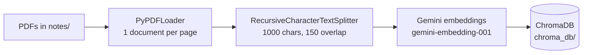
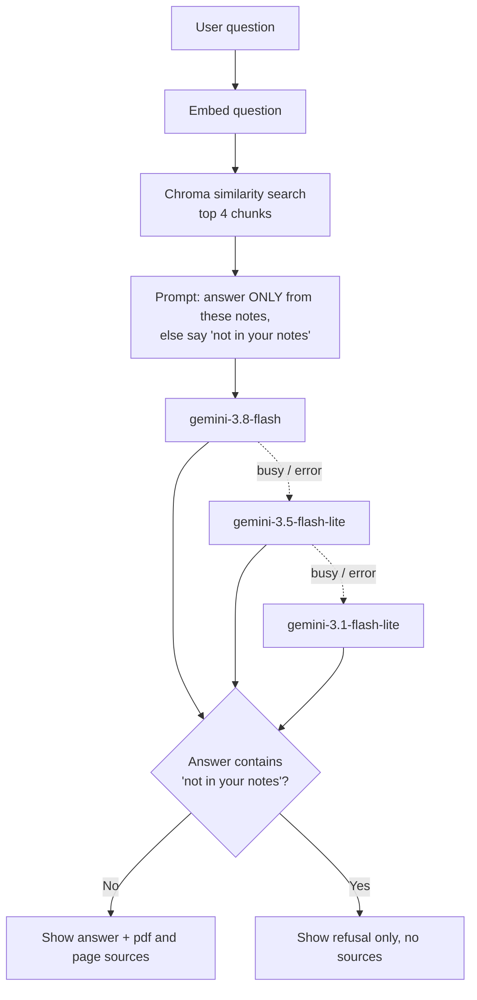

# Exam Season Survival RAG

Ask questions about your own study notes and get answers **only from your PDFs**, with the source file and page. If the answer isn't in your notes, it says so instead of making something up.

## Why this exists

Chatbots answer confidently even when they're wrong. For exam prep that's dangerous. This project forces the model to stay inside your notes and to admit when the answer isn't there.

## Architecture

### 1. Ingestion (run once per set of notes)



### 2. Query (every question)



## Design decisions

| Decision | Why |
|---|---|
| Chunk size 1000, overlap 150 | Big enough to keep a full idea together, overlap stops sentences being cut in half |
| Page metadata kept | Lets every answer point to the exact pdf and page |
| `temperature=0` | Sticks to the notes, no creativity |
| Strict prompt with exact refusal phrase | Makes "not in your notes" predictable and checkable in code |
| Sources hidden on refusal | Search always returns the 4 closest chunks even if none are relevant, so showing them would be misleading |
| Model fallback chain + retries | Gemini returns 503 during demand spikes, so the app tries backup models instead of crashing |
| Same embedding model for ingest and query | Vectors from different models can't be compared |

## Project structure

```
rag-exam-season-survival/
├── ingest.py        # load pdfs, chunk, embed, save to Chroma
├── query.py         # ask questions in the terminal
├── notes/           # your PDFs go here
├── chroma_db/       # generated vector store (gitignored)
└── README.md
```

## Setup

```bash
python -m venv .venv
source .venv/bin/activate
pip install langchain langchain-google-genai langchain-chroma langchain-community langchain-text-splitters pypdf
export GOOGLE_API_KEY="your_key"   # or use a Codespaces secret

# add your own PDFs to notes/
python ingest.py
python query.py
```

## Example

```
ask: what is deep learning?

Deep Learning (DL) is a subfield of Machine Learning that uses artificial
neural networks with many layers to learn patterns directly from data.

sources:
  - Unit1_Deep_Learning.pdf, page 3

ask: who won the world cup?

not in your notes
```

## Testing I did

- In-notes questions return the right answer with correct pages
- Typos still work ("deep learing"), since search is by meaning
- Out-of-notes questions ("who won the world cup") are refused
- Checked a refusal ("what is hidden state") by scanning the PDFs directly: the notes only mention *hidden layers*, so the refusal was correct

## Limitations

- Refusal is detected by matching the phrase "not in your notes", which is simple but depends on the model following the prompt
- Always retrieves a fixed top 4 chunks, with no relevance cutoff yet
- PDF text only, scanned or image-only pages are not read (no OCR)
- Terminal only, and no memory between questions

## What I learned

- Similarity search always returns *something*, so grounding comes from the prompt rule plus checking the answer, not from retrieval alone
- Newer Gemini models return content as a list of blocks, so use `.text` instead of `.content`
- Model names get retired quickly, so fallbacks matter
- Verify a "not found" answer against the source before trusting or blaming the model

## Roadmap

- [ ] Relevance score cutoff before calling the model
- [ ] Simple web UI
- [ ] OCR for scanned pages
- [ ] Evaluation set of questions with expected answers

## Stack

Python · LangChain · ChromaDB · Google Gemini (embeddings + chat)